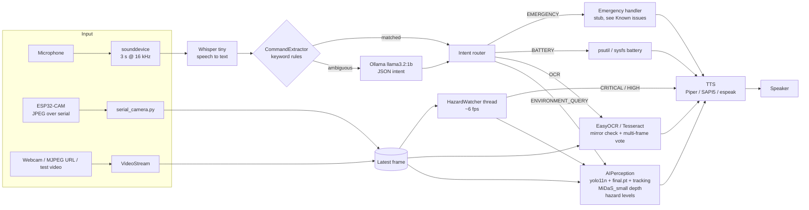

# Ru'ya Smart Glasses

Voice-controlled assistive glasses for visually impaired users: a Raspberry Pi listens for spoken commands, looks through an ESP32-CAM, and answers out loud with obstacle distances, read-aloud text and device status, fully offline.


## Overview

People with visual impairments need fast, hands-free answers to questions like *"what's in front of me?"* or *"what does this sign say?"*, without depending on a cloud connection. Ru'ya ("vision" in Arabic) runs the whole loop on-device: speech in, perception, speech out.

Key features (all implemented in this repository):

- **Voice commands**: 3-second microphone recording (`sounddevice`), transcribed by **Whisper `tiny`** on CPU.
- **Intent extraction**: `CommandExtractor` maps the transcript to `ENVIRONMENT_QUERY`, `OCR`, `BATTERY`, `EMERGENCY` or `UNKNOWN`. Keyword rules handle the common phrasings instantly; only ambiguous input goes to a local **Ollama `llama3.2:1b`** model that returns JSON (intent + `target` + `location_hint`).
- **Scene perception** (`ai_perception.py`):
  - two YOLO models run with tracking: stock **`yolo11n.pt`** (COCO classes) and a custom **`final.pt`** for indoor structure (`ceiling`, `door`, `wall`, `window`, `object`);
  - overlapping detections from both models are merged by IoU (threshold 0.60);
  - **MiDaS_small** monocular depth (via `torch.hub`) gives an approximate distance per object (mapped to 0.5–10 m, smoothed over time), with a bounding-box-size fallback if MiDaS can't load;
  - each object gets a direction (left / ahead / right), a motion label (APPROACHING / LEAVING / STATIC) from its depth history, and a hazard level: **CRITICAL** (≤ 1.5 m), **HIGH** (≤ 3.5 m) or **SAFE**.
- **Proactive hazard warnings**: a background `HazardWatcher` thread checks frames at about 6 fps and speaks "Warning!" / "Caution." messages for CRITICAL/HIGH objects, with a per-class cooldown so it doesn't repeat itself.
- **Read text aloud**: EasyOCR (Tesseract fallback). It runs on the frame and its mirror image and keeps the more text-like result, votes across several frames, and, for requests like *"read the menu"*, OCRs only the frames where YOLO detects the requested object.
- **Battery status**: via `psutil`, falling back to `/sys/class/power_supply` on Linux.
- **Offline text-to-speech**: Piper (Python package or CLI) with a local ONNX voice, falling back to Windows SAPI5 (`text_to_speech.py`) or espeak on the Pi (`text_to_speech_pi.py`).
- **ESP32-CAM over USB-serial**: an Arduino sketch streams JPEG frames in a simple framed protocol (`AA BB | type | length | payload | BB AA`), and `serial_camera.py` decodes them on the Pi. Local webcams, `/dev/video*` devices, an MJPEG URL or a test video also work.
- **One-command Pi deployment**: `ssh_deploy.py` uploads the code and models over SFTP, installs dependencies from pre-built ARM64 wheels, caches Whisper and MiDaS weights for offline use, and installs a `ruya.service` systemd unit.

### Hardware

The code expects the following hardware. Exact models are not pinned in the code:

| Part | Evidence in code |
|---|---|
| Raspberry Pi (64-bit OS, ARM64) | `ssh_deploy.py` installs aarch64 wheels and the `piper_arm64` binary; `ocr_processor.py` mentions Raspberry Pi 4 [TODO: confirm exact Pi model and RAM] |
| ESP32-CAM | `esp32cam_serial.ino` (GPIO map matches the common AI-Thinker ESP32-CAM board [TODO: confirm board]) connected over a USB-TTL adapter (`/dev/ttyUSB0`) |
| USB microphone and speaker / headphones | `sounddevice` recording; playback via `aplay` / `paplay` / `ffplay` on the Pi |
| Glasses frame, battery pack | [TODO: confirm, not described in the code] |

## Architecture



## Tech stack

| Area | Choice | Why (as reflected in the code) |
|---|---|---|
| Speech-to-text | `openai-whisper` (`tiny`, CPU, `fp16=False`) | Small enough to run on a Pi; the model is loaded once and reused |
| Intent extraction | Keyword rules + Ollama `llama3.2:1b` (`format="json"`, temperature 0) | Rules give instant, deterministic results for the common commands (emergency is checked first); the small local LLM handles everything else offline |
| Object detection | Ultralytics YOLO11n + custom `final.pt`, with `model.track(persist=True)` | Two models cover both COCO objects and indoor structure; tracking IDs enable per-object depth smoothing and motion detection |
| Depth | MiDaS_small via `torch.hub` | Monocular depth from a single cheap camera, with no stereo or LiDAR hardware |
| OCR | EasyOCR, falling back to pytesseract | EasyOCR works on CPU and ARM64; Tesseract is a lighter fallback |
| TTS | Piper (ONNX voice), SAPI5 / espeak fallback | Natural offline voice with a guaranteed fallback |
| Camera link | ESP32-CAM + pyserial, framed JPEG | The Pi reads frames over USB-serial, so no Wi-Fi network is needed |
| Deployment | paramiko (SSH/SFTP) + systemd | Repeatable install on a headless Pi that auto-starts on boot |

## Demo / Screenshots

<!-- TODO: add a screenshot at docs/screenshot.png -->


*TODO for the owner: capture a photo of the glasses hardware and/or an annotated frame from `ai_perception.py` (boxes with distance, hazard level and the PATH corridor), and save it as `docs/screenshot.png`. A short demo video link would also help.*

## Dataset and model weights

No datasets or weights are included in this repository (`*.pt`, `*.onnx`, `*.mp4` etc. are gitignored).

| File | What it is | How to get it | Where it goes |
|---|---|---|---|
| `yolo11n.pt` | Stock Ultralytics YOLO11n (COCO, 80 classes) | Not auto-downloaded at runtime: `AIPerception` checks that the file exists before loading it and raises `FileNotFoundError` otherwise. Download it once from the repo root with `python -c "from ultralytics import YOLO; YOLO('yolo11n.pt')"` | repo root |
| `final.pt` | Custom-trained YOLO model for indoor structure. The class map in `ai_perception.py` is `0 ceiling, 1 door, 2 wall, 3 window, 4 object` | **Not included.** [TODO: confirm how to share it, e.g. as a GitHub Release asset; also document the training dataset, its size and license] | repo root |
| MiDaS_small | Intel ISL MiDaS depth model | Downloaded automatically by `torch.hub` on first use (cached in `~/.cache/torch/hub`) | automatic |
| Whisper `tiny` | OpenAI Whisper weights | Downloaded automatically by `whisper.load_model` on first use (`~/.cache/whisper`) | automatic |
| `llama3.2:1b` | Ollama model for intent fallback | `ollama pull llama3.2:1b` | Ollama's own store |
| Piper voice | e.g. `en_US-amy-medium.onnx` + `.onnx.json` (preferred by the code) | Download from the Piper voices collection [TODO: confirm source and voice license] | `tts_models/` |
| `torch_wheels/` | Pre-built aarch64 wheels used by the offline Pi install | Built or collected by the owner, not included [TODO: confirm how to reproduce] | repo root (only needed for `ssh_deploy.py`) |
| `testvideo.mp4` / `streetsun.mp4` | Optional test videos for `RUYA_VIDEO_SOURCE=video` and for the standalone `ai_perception.py` | Any walking-scene video | repo root |

Expected layout:

```
ruya-smart-glasses/
├── yolo11n.pt
├── final.pt
├── tts_models/
│   ├── en_US-amy-medium.onnx
│   └── en_US-amy-medium.onnx.json
└── torch_wheels/           # only for ssh_deploy.py
```

## Installation

Requires Python 3.11 (the version the Pi deployment builds), [Ollama](https://ollama.com) and, for OCR fallback, optionally Tesseract.

```bash
git clone https://github.com/aliyahseri/ruya-smart-glasses.git
cd ruya-smart-glasses

python -m venv .venv
# Windows
.venv\Scripts\activate
# macOS / Linux
source .venv/bin/activate

pip install -r requirements.txt

# Models
ollama pull llama3.2:1b
python -c "from ultralytics import YOLO; YOLO('yolo11n.pt')"   # downloads yolo11n.pt into the repo root
# place final.pt in the repo root and a Piper voice in tts_models/ (see above)
```

Platform notes:
- `text_to_speech.py` imports `winsound` and uses SAPI5, so **on Linux/macOS it fails to import** (and `orchestrator.py` with it). On Linux, copy `text_to_speech_pi.py` over `text_to_speech.py`, which is exactly what `ssh_deploy.py` does on the Pi. Install `espeak-ng` and `alsa-utils` for the fallback voice and playback.
- **Run everything from the repo root.** Model paths (`yolo11n.pt`, `final.pt`) are relative to the working directory.

## Usage

### Run the assistant

```bash
python orchestrator.py interactive   # press Enter, then speak a command (type 'quit' to exit)
python orchestrator.py continuous    # listen -> answer loop, Ctrl+C to stop
python orchestrator.py single        # one command, then exit
python orchestrator.py vision        # print scene descriptions to stdout every RUYA_VISION_INTERVAL seconds
```

Example commands: *"what's in front of me?"*, *"is there a chair to my left?"*, *"read the menu"*, *"what does the sign say?"*, *"how much battery do I have?"*, *"help"*.

Camera selection (environment variables; see `.env.example`):

| Variable | Effect |
|---|---|
| `RUYA_VIDEO_SOURCE` | `camera` (default) or `video` |
| `RUYA_TEST_VIDEO_PATH` | video file used when `video` (default `testvideo.mp4`) |
| `RUYA_CAMERA_INDEX` | OpenCV camera index |
| `RUYA_CAMERA_URL` | MJPEG URL, e.g. an ESP32-CAM Wi-Fi stream `http://<esp32-ip>:81/stream` |
| `RUYA_SERIAL_PORT` / `RUYA_SERIAL_BAUD` | ESP32-CAM over USB-serial (Linux only), default baud 921600 |
| `RUYA_TTS_ENGINE`, `RUYA_TTS_SPEED`, `RUYA_PIPER_*` | TTS engine selection and voice |

### Individual components

```bash
python ai_perception.py                       # standalone: annotates streetsun.mp4 -> streetsun_output_finalll.mp4
python speech_command_integration.py          # speech -> JSON command loop (no perception)
python speech_command_integration.py --test   # single speech -> JSON test
python ocr_processor.py                       # show which OCR backends are available
python text_to_speech.py "Hello from Ru'ya"   # TTS smoke test
python test_extractor.py                      # unit tests for CommandExtractor
```

### ESP32-CAM

Flash `esp32cam_serial.ino` with the Arduino IDE (ESP32 board package), connect the ESP32-CAM to the Pi via a USB-TTL adapter, and set `RUYA_SERIAL_PORT`. **The sketch's `SERIAL_BAUD_RATE` (1152000) must match `RUYA_SERIAL_BAUD`** (see Known issues).

### Deploy to a Raspberry Pi

```bash
cp .env.example .env      # then set PI_HOST, PI_USER, PI_PASSWORD
pip install paramiko python-dotenv
python ssh_deploy.py      # uploads code + models, installs deps, installs/starts ruya.service
python install_ollama_pi.py     # installs Ollama on the Pi and pulls llama3.2:1b
python verify_pi.py             # checks Whisper models and `import orchestrator` on the Pi
python pi_exec.py "systemctl status ruya.service"   # run any remote command
python pi_patch.py              # re-upload orchestrator/perception/serial camera and restart the service
```

`ssh_deploy.py` requires a local `torch_wheels/` folder of aarch64 wheels (it aborts without it). The project is uploaded to `~/ruya-copy` on the Pi, and the systemd unit runs `orchestrator.py vision` with the serial camera on `/dev/ttyUSB0`. Logs: `journalctl -u ruya.service -n 200 --no-pager`.

## Results

No accuracy, latency or FPS benchmarks are saved in this repository, so none are claimed here. `test_extractor.py` runs 23 unit tests for the command extractor; in a local run with the Ollama client stubbed out, 21 pass and 2 fail (see Known issues). [TODO: confirm and add measured numbers, e.g. end-to-end response time and FPS on the Pi, and `final.pt` validation mAP]

## Project structure

```
ruya-smart-glasses/
├── orchestrator.py               # main entry point: modes, intent routing, VideoStream, HazardWatcher, battery
├── ai_perception.py              # YOLO11n + final.pt + tracking, MiDaS depth, hazard levels
├── command_extractor.py          # rule-based + Ollama intent/entity extraction
├── speech_command_integration.py # microphone recording + Whisper STT
├── ocr_processor.py              # EasyOCR / Tesseract wrapper
├── text_to_speech.py             # TTS for Windows (Piper / SAPI5)
├── text_to_speech_pi.py          # TTS for the Pi (Piper / espeak), deployed as text_to_speech.py
├── serial_camera.py              # ESP32-CAM serial frame decoder
├── esp32cam_serial.ino           # ESP32-CAM firmware: JPEG frames over UART
├── ssh_deploy.py                 # full Raspberry Pi deployment + systemd service
├── pi_patch.py, pi_exec.py, verify_pi.py, install_ollama_pi.py, upload_whisper_models.py  # Pi helpers
├── test_extractor.py             # unittest suite for CommandExtractor
├── cv2.py                        # dev hack that shadows OpenCV, see Known issues
├── orchestrator1.py              # older orchestrator version (no camera)
├── *.py (test2, try, text, find_cam, ...) # scratch/dev scripts, see Known issues
├── requirements.txt
└── .env.example
```

## Challenges & what I learned

- **Tracker cold start**: on the first frame of a new tracking sequence every YOLO box has `id=None`, and skipping those boxes made the system answer "no objects" while objects were clearly visible. The fix assigns fallback IDs, and environment queries warm the tracker up over 15 frames before answering.
- **Turning relative depth into spoken metres**: MiDaS outputs relative inverse depth, so the code normalises each frame, maps it linearly to 0.5–10 m, samples the lower-middle of each box, and applies exponential smoothing. The distances are rough estimates, not calibrated measurements.
- **Running on a Raspberry Pi**: CPU-only inference everywhere (CUDA explicitly disabled), Whisper `tiny`, a 1B LLM used only as a fallback, an offline install from pre-built aarch64 wheels, and pre-cached Whisper/MiDaS weights.
- **Robust OCR from a head-mounted camera**: the code OCRs both the frame and its mirror image (to handle mirrored camera output), scores candidates on how text-like they are, and votes across frames.
- **A reliable camera link**: a custom start/end-marked packet format over UART, with a raw JPEG SOI/EOI fallback parser, lets the ESP32-CAM stream to the Pi without Wi-Fi.
- [TODO: confirm: team size, your role, and what you personally built]

## Known issues & limitations

- **Safety caveat, emergency is a stub**: `_handle_emergency` (`orchestrator.py` ~L1017) only prints "EMERGENCY TRIGGERED" and tells the user "Notifying your contacts... help is on the way", but **no one is notified** (haptic/BLE alert is a TODO). Don't rely on it.
- **`cv2.py` in the repo root shadows OpenCV**: any script run from the root that does `import cv2` gets this module. It re-imports the real OpenCV and monkey-patches `VideoCapture` so any source containing `testvideo.mp4` is redirected to a hardcoded ESP32 stream (`http://192.168.1.54:81/stream`). `ssh_deploy.py` excludes it from the Pi upload. It should be removed.
- **Custom classes are never hazards**: `final.pt` classes (`door`, `wall`, `window`, `ceiling`, `object`) are not in `HAZARD_CLASSES` (`ai_perception.py`), so they are always SAFE, even at 0.5 m.
- **Walking corridor is not used for hazard level**: `in_user_path()` is computed and drawn, but `HazardTracker.classify()` ignores `in_path`; hazard level depends only on class and distance.
- **HazardWatcher direction is always empty**: `_build_warning` checks `obj.bbox`, but `DetectedObject` has no `bbox` field, so warnings never say left/right/ahead.
- **The Pi service gives no spoken output**: the systemd unit runs `orchestrator.py vision`, which disables HazardWatcher and only `print`s descriptions. There is no TTS and no voice commands in that mode.
- **Baud-rate mismatch**: `esp32cam_serial.ino` uses `SERIAL_BAUD_RATE 1152000`, but the Pi defaults and the systemd unit use `RUYA_SERIAL_BAUD=921600`.
- **Relative model paths**: `yolo11n.pt`, `final.pt` and `streetsun.mp4` are resolved against the working directory, so you must run from the repo root.
- **`text_to_speech.py` is Windows-only** (`import winsound`, SAPI5); importing `orchestrator.py` on Linux fails unless the Pi variant is swapped in.
- **`ocr_example.py` crashes**: it defines `simple_cr_example` but calls `simple_ocr_example` (NameError).
- **`test_extractor.py` mocks are mostly ineffective**: tests patch `_call_llm`, but nearly every input matches a keyword fast path before the LLM is reached; `test_basic` also patches a throwaway instance (`patch.object(ext(), ...)`) and then calls a different, unpatched instance. Two tests fail (`test_with_target`, `test_what_does_sign_say`) because the rule fast path doesn't extract those targets.
- **Stale docstrings**: `orchestrator.py` and `orchestrator1.py` headers still mention PaddleOCR and pyttsx3 (the code uses EasyOCR/Tesseract and Piper/SAPI5/espeak).
- **Minor code smells** in `orchestrator.py`: `threading` and `time` imported twice (L59-60 and L65); `HAZARD_COOLDOWN` / `HAZARD_LOOP_INTERVAL` defined twice.
- **Deployment security**: SSH uses password auth with `paramiko.AutoAddPolicy()` (no host-key verification), and `install_ollama_pi.py` runs `curl -fsSL https://ollama.com/install.sh | sh` on the Pi. This is fine on a trusted LAN, but use SSH keys and known_hosts for anything else.
- **Hardcoded LAN IPs in dev scripts**: `cv2.py` (`192.168.1.54`) and `text.py` (`192.168.1.100`) point at local ESP32-CAM streams. These are private LAN addresses, not secrets.
- **Root clutter**: scratch/dev scripts (`test2.py`, `try.py`, `text.py`, `find_cam.py`, `test_import.py`, `test_mkldnn.py`, `test_ocr_direct.py`, `debug_ocr_stepwise.py`, `try_ocr_pipeline.py`, `record_audio.py`, `speech_to_text.py`, `orchestrator1.py`) sit next to the main modules. `try.py` uses a different Ollama model (`qwen2.5:1.5b`).
- **Distances are approximate**: MiDaS depth is relative, and the 0.5–10 m mapping is a heuristic, not a calibration.

## Future improvements

- Implement a real emergency path (GPIO haptic alert, BLE/SMS to a companion app) or remove the "help is on the way" message until it exists.
- Delete `cv2.py`, and move scratch scripts into a `scripts/` or `dev/` folder.
- Add the custom classes (or a separate obstacle list) to the hazard logic and use the walking corridor (`in_path`) when ranking hazards.
- Enable speech output for the systemd service (run `continuous` mode or speak HazardWatcher alerts in `vision` mode) and align the ESP32/Pi baud rates.
- Resolve model paths relative to `__file__`, and make TTS selection automatic per OS instead of swapping files.
- Fix the test suite so it exercises the LLM path, and add CI.
- Use SSH key auth with host-key verification in the deploy scripts.
- Publish `final.pt` (e.g. as a GitHub Release) with its training details and evaluation metrics.

## Credits / Acknowledgements

- [Ultralytics YOLO](https://github.com/ultralytics/ultralytics) (YOLO11n weights, AGPL-3.0)
- [MiDaS](https://github.com/isl-org/MiDaS) by Intel ISL (loaded via `torch.hub`)
- [OpenAI Whisper](https://github.com/openai/whisper)
- [Ollama](https://ollama.com) and Meta Llama 3.2 1B
- [EasyOCR](https://github.com/JaidedAI/EasyOCR), [Tesseract](https://github.com/tesseract-ocr/tesseract)
- [Piper TTS](https://github.com/rhasspy/piper) and its voice models (check each voice's license)
- Espressif `esp32-camera` driver (used by the ESP32-CAM sketch)
- Team members / collaborators: [TODO: confirm]

Note: these dependencies keep their own licenses. In particular, Ultralytics YOLO is AGPL-3.0, which matters if you redistribute or serve the model.

## License

MIT, see [LICENSE](LICENSE). Third-party models and libraries are under their own licenses (see Credits).

## Author

**Aliyah Seri**
- GitHub: [aliyahseri](https://github.com/aliyahseri)
